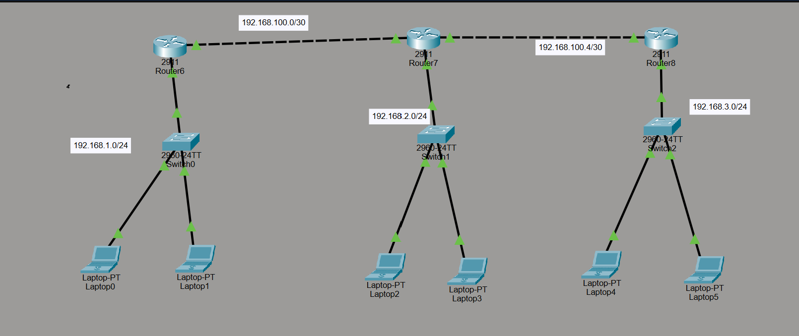

# Static Routing Lab – Cisco Packet Tracer


## 1. Lab Overview

**Objective:** Connect three LAN networks through three routers using Static Routing and enable end-to-end communication between all laptops.

### Devices Used
- 3 × Cisco 2911 Routers (Router6, Router7, Router8)
- 3 × Cisco 2960 Switches
- 6 × Laptops
- Ethernet cables

### Network Topology

```text
LAN 1                  LAN 2                  LAN 3
192.168.1.0/24         192.168.2.0/24         192.168.3.0/24
     |                      |                      |
  Router6 --------------- Router7 --------------- Router8
        192.168.100.0/30       192.168.100.4/30
```

## 2. What Is Static Routing?

Static Routing is a routing method where the network administrator manually configures routes to remote networks.

**Advantages**
- Simple to configure in small networks.
- Does not require a routing protocol.
- Provides predictable routing paths.

**Disadvantages**
- Routes must be configured and updated manually.
- Does not automatically adapt to a failed link.
- Becomes difficult to maintain in large networks.

## 3. IP Addressing Table

The following is a suggested working IP plan based on your topology. The exact interface assignments may need adjustment to match your Packet Tracer connections.

### Router Interfaces

| Router | Interface | IP Address | Subnet Mask |
|---|---|---|---|
| Router6 | G0/0 – LAN 1 | 192.168.1.1 | 255.255.255.0 |
| Router6 | G0/1 – Router7 | 192.168.100.1 | 255.255.255.252 |
| Router7 | G0/0 – LAN 2 | 192.168.2.1 | 255.255.255.0 |
| Router7 | G0/1 – Router6 | 192.168.100.2 | 255.255.255.252 |
| Router7 | G0/2 – Router8 | 192.168.100.5 | 255.255.255.252 |
| Router8 | G0/0 – LAN 3 | 192.168.3.1 | 255.255.255.0 |
| Router8 | G0/1 – Router7 | 192.168.100.6 | 255.255.255.252 |

**Important:** The first inter-router network must be `192.168.100.0/30`, not `/32`, for the two-interface addressing shown above.

### Laptop IP Configuration

| Laptop | IP Address | Subnet Mask | Default Gateway |
|---|---|---|---|
| Laptop0 | 192.168.1.10 | 255.255.255.0 | 192.168.1.1 |
| Laptop1 | 192.168.1.11 | 255.255.255.0 | 192.168.1.1 |
| Laptop2 | 192.168.2.10 | 255.255.255.0 | 192.168.2.1 |
| Laptop3 | 192.168.2.11 | 255.255.255.0 | 192.168.2.1 |
| Laptop4 | 192.168.3.10 | 255.255.255.0 | 192.168.3.1 |
| Laptop5 | 192.168.3.11 | 255.255.255.0 | 192.168.3.1 |

Configure laptop addresses from **Desktop → IP Configuration**.

## 4. Router Configuration

### Router6 Configuration

```cisco
enable
configure terminal
hostname Router6

interface gigabitEthernet 0/0
 ip address 192.168.1.1 255.255.255.0
 no shutdown
exit

interface gigabitEthernet 0/1
 ip address 192.168.100.1 255.255.255.252
 no shutdown
exit

! Route to LAN 2 through Router7
ip route 192.168.2.0 255.255.255.0 192.168.100.2

! Route to LAN 3 through Router7
ip route 192.168.3.0 255.255.255.0 192.168.100.2

end
copy running-config startup-config
```

### Router7 Configuration

```cisco
enable
configure terminal
hostname Router7

interface gigabitEthernet 0/0
 ip address 192.168.2.1 255.255.255.0
 no shutdown
exit

interface gigabitEthernet 0/1
 ip address 192.168.100.2 255.255.255.252
 no shutdown
exit

interface gigabitEthernet 0/2
 ip address 192.168.100.5 255.255.255.252
 no shutdown
exit

! Route to LAN 1 through Router6
ip route 192.168.1.0 255.255.255.0 192.168.100.1

! Route to LAN 3 through Router8
ip route 192.168.3.0 255.255.255.0 192.168.100.6

end
copy running-config startup-config
```

### Router8 Configuration

```cisco
enable
configure terminal
hostname Router8

interface gigabitEthernet 0/0
 ip address 192.168.3.1 255.255.255.0
 no shutdown
exit

interface gigabitEthernet 0/1
 ip address 192.168.100.6 255.255.255.252
 no shutdown
exit

! Route to LAN 1 through Router7
ip route 192.168.1.0 255.255.255.0 192.168.100.5

! Route to LAN 2 through Router7
ip route 192.168.2.0 255.255.255.0 192.168.100.5

end
copy running-config startup-config
```

**Interface note:** These commands assume the interfaces match the suggested table. If your actual connections use different interfaces, configure the corresponding interfaces instead.

## 5. Understanding the Static Route Command

```cisco
ip route 192.168.1.0 255.255.255.0 192.168.100.2
```

| Component | Meaning |
|---|---|
| `ip route` | Creates a static route |
| `192.168.1.0` | Destination network |
| `255.255.255.0` | Destination subnet mask |
| `192.168.100.2` | Next-hop router IP |

The next-hop IP must be reachable through a directly connected network.

## 6. Routing Tables

A router's routing table contains directly connected networks, local interface addresses and routes learned or configured through routing mechanisms.

### Router6 – Expected Routes

| Destination | Type | Next Hop / Interface |
|---|---|---|
| 192.168.1.0/24 | Connected (C) | G0/0 |
| 192.168.100.0/30 | Connected (C) | G0/1 |
| 192.168.2.0/24 | Static (S) | 192.168.100.2 |
| 192.168.3.0/24 | Static (S) | 192.168.100.2 |

### Router7 – Expected Routes

| Destination | Type | Next Hop / Interface |
|---|---|---|
| 192.168.2.0/24 | Connected (C) | G0/0 |
| 192.168.100.0/30 | Connected (C) | G0/1 |
| 192.168.100.4/30 | Connected (C) | G0/2 |
| 192.168.1.0/24 | Static (S) | 192.168.100.1 |
| 192.168.3.0/24 | Static (S) | 192.168.100.6 |

### Router8 – Expected Routes

| Destination | Type | Next Hop / Interface |
|---|---|---|
| 192.168.3.0/24 | Connected (C) | G0/0 |
| 192.168.100.4/30 | Connected (C) | G0/1 |
| 192.168.1.0/24 | Static (S) | 192.168.100.5 |
| 192.168.2.0/24 | Static (S) | 192.168.100.5 |

Actual routing tables also contain local `/32` routes (marked `L`) for interface IP addresses. The tables above summarize the main routes.

## 7. Packet Forwarding Process

### Example: Laptop0 to Laptop5

Source: `192.168.1.10`  
Destination: `192.168.3.11`

1. Laptop0 identifies that the destination is outside its local subnet.
2. Laptop0 sends the packet to its default gateway, `192.168.1.1`.
3. Router6 checks its routing table and matches `192.168.3.0/24`.
4. Router6 forwards the packet to Router7 at `192.168.100.2`.
5. Router7 matches `192.168.3.0/24` and forwards the packet to Router8 at `192.168.100.6`.
6. Router8 identifies `192.168.3.0/24` as directly connected and sends the packet to Laptop5 through its LAN interface.
7. The reply travels back through Router8 → Router7 → Router6 using the return routes.

### Forwarding Summary

| Router | Destination | Forward To |
|---|---|---|
| Router6 | 192.168.3.11 | 192.168.100.2 |
| Router7 | 192.168.3.11 | 192.168.100.6 |
| Router8 | 192.168.3.11 | Local LAN interface |

## 8. Verification Commands

### Check Interface Status

```cisco
show ip interface brief
```

Interfaces should be `up/up` for normal forwarding.

### Check Routing Table

```cisco
show ip route
```

Look for:
- `C` – Connected route
- `L` – Local interface address
- `S` – Static route

### Check Static Routes

```cisco
show running-config
```

### Test Router-to-Router Connectivity

From Router6:

```cisco
ping 192.168.100.2
```

From Router7:

```cisco
ping 192.168.100.6
```

### Test End-to-End Connectivity

From Laptop0's Command Prompt:

```text
ping 192.168.1.1
ping 192.168.2.10
ping 192.168.3.11
```

If the first ping fails but later pings succeed, ARP resolution may have caused the initial timeout.

## 9. Troubleshooting

| Problem | Possible Solution |
|---|---|
| `Invalid input detected` | Check command spelling, subnet mask and IOS syntax |
| Interface is down | Check cable and apply `no shutdown` |
| Direct router ping fails | Check interface IPs and subnet masks |
| Remote LAN ping fails | Check static routes on every router |
| Laptop cannot reach remote LAN | Check its IP, subnet mask and default gateway |
| Return ping fails | Ensure the reverse path has the required routes |

### Useful Commands

```cisco
show ip interface brief
show ip route
show running-config
show interfaces
```

## 10. Lab Conclusion

In this lab, three LANs were connected using three routers. Static routes were configured to reach remote networks, and routing tables were used to determine the next hop for packet forwarding.

**Key takeaway:** Every router must know how to reach the destination network, and the return path must also be available for successful end-to-end communication.
