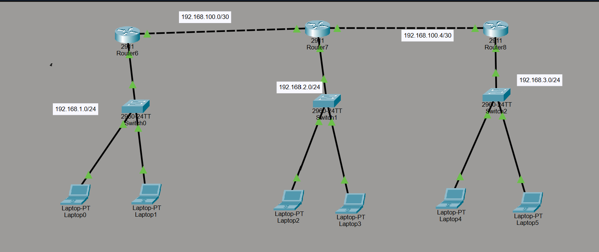

# Cisco Packet Tracer: Static Routing Lab



## ১. ল্যাবের উদ্দেশ্য

তিনটি আলাদা LAN-কে তিনটি রাউটারের মাধ্যমে সংযুক্ত করা এবং Static Routing ব্যবহার করে সব ল্যাপটপের মধ্যে যোগাযোগ স্থাপন করা।

### ব্যবহৃত ডিভাইস

- ৩টি Cisco 2911 Router
- ৩টি Cisco 2960 Switch
- ৬টি Laptop
- প্রয়োজনীয় Ethernet Cable

### নেটওয়ার্ক টপোলজি

```text
LAN 1                  LAN 2                  LAN 3
192.168.1.0/24         192.168.2.0/24         192.168.3.0/24
     |                      |                      |
  Router6 --------------- Router7 --------------- Router8
      192.168.100.0/30        192.168.100.4/30
```

## ২. Static Routing কী?

Static Routing হলো এমন একটি Routing পদ্ধতি, যেখানে নেটওয়ার্ক অ্যাডমিনিস্ট্রেটর ম্যানুয়ালি রাউটারের Routing Table-এ দূরবর্তী নেটওয়ার্কের Route যুক্ত করেন।

**সুবিধা:**
- ছোট নেটওয়ার্কে কনফিগার করা সহজ।
- আলাদা Routing Protocol প্রয়োজন হয় না।
- নির্দিষ্ট Route ও Next-Hop নিয়ন্ত্রণ করা যায়।

**অসুবিধা:**
- প্রতিটি Route ম্যানুয়ালি কনফিগার করতে হয়।
- লিংক নষ্ট হলে স্বয়ংক্রিয়ভাবে বিকল্প পথ তৈরি হয় না।
- বড় নেটওয়ার্কে পরিচালনা করা কঠিন।

## ৩. IP Address পরিকল্পনা

নিচের IP Address-গুলো একটি প্রস্তাবিত কনফিগারেশন। তোমার Packet Tracer Lab-এ Interface-এর নাম বা IP Address আলাদা হলে সেগুলোর সঙ্গে মিলিয়ে নেবে।

### Router Interface-এর IP Address

| Router | Interface | IP Address | Subnet Mask |
|---|---|---|---|
| Router6 | G0/0 | 192.168.1.1 | 255.255.255.0 |
| Router6 | G0/1 | 192.168.100.1 | 255.255.255.252 |
| Router7 | G0/0 | 192.168.2.1 | 255.255.255.0 |
| Router7 | G0/1 | 192.168.100.2 | 255.255.255.252 |
| Router7 | G0/2 | 192.168.100.5 | 255.255.255.252 |
| Router8 | G0/0 | 192.168.3.1 | 255.255.255.0 |
| Router8 | G0/1 | 192.168.100.6 | 255.255.255.252 |

**গুরুত্বপূর্ণ:** প্রথম Router-to-Router লিংকের জন্য এখানে `192.168.100.0/30` ব্যবহার করা হয়েছে। ছবিতে `/32` লেখা থাকলে সেটি যাচাই করবে। `/32` এবং `/30` এক নয়।

### Laptop-এর IP Configuration

| Laptop | IP Address | Subnet Mask | Default Gateway |
|---|---|---|---|
| Laptop0 | 192.168.1.10 | 255.255.255.0 | 192.168.1.1 |
| Laptop1 | 192.168.1.11 | 255.255.255.0 | 192.168.1.1 |
| Laptop2 | 192.168.2.10 | 255.255.255.0 | 192.168.2.1 |
| Laptop3 | 192.168.2.11 | 255.255.255.0 | 192.168.2.1 |
| Laptop4 | 192.168.3.10 | 255.255.255.0 | 192.168.3.1 |
| Laptop5 | 192.168.3.11 | 255.255.255.0 | 192.168.3.1 |

ল্যাপটপে IP সেট করার জন্য:

`Desktop → IP Configuration`

সেখানে IP Address, Subnet Mask এবং Default Gateway বসাবে।

## ৪. Router কনফিগারেশন

### Router6 Configuration

```cisco
enable
configure terminal
hostname Router6

interface gigabitEthernet 0/0
 ip address 192.168.1.1 255.255.255.0
 no shutdown
exit

interface gigabitEthernet 0/1
 ip address 192.168.100.1 255.255.255.252
 no shutdown
exit

! LAN 2-তে যাওয়ার Route
ip route 192.168.2.0 255.255.255.0 192.168.100.2

! LAN 3-তে যাওয়ার Route
ip route 192.168.3.0 255.255.255.0 192.168.100.2

end
copy running-config startup-config
```

### Router7 Configuration

```cisco
enable
configure terminal
hostname Router7

interface gigabitEthernet 0/0
 ip address 192.168.2.1 255.255.255.0
 no shutdown
exit

interface gigabitEthernet 0/1
 ip address 192.168.100.2 255.255.255.252
 no shutdown
exit

interface gigabitEthernet 0/2
 ip address 192.168.100.5 255.255.255.252
 no shutdown
exit

! LAN 1-এ যাওয়ার Route
ip route 192.168.1.0 255.255.255.0 192.168.100.1

! LAN 3-এ যাওয়ার Route
ip route 192.168.3.0 255.255.255.0 192.168.100.6

end
copy running-config startup-config
```

### Router8 Configuration

```cisco
enable
configure terminal
hostname Router8

interface gigabitEthernet 0/0
 ip address 192.168.3.1 255.255.255.0
 no shutdown
exit

interface gigabitEthernet 0/1
 ip address 192.168.100.6 255.255.255.252
 no shutdown
exit

! LAN 1-এ যাওয়ার Route
ip route 192.168.1.0 255.255.255.0 192.168.100.5

! LAN 2-এ যাওয়ার Route
ip route 192.168.2.0 255.255.255.0 192.168.100.5

end
copy running-config startup-config
```

**নোট:** Interface-এর নাম তোমার Router-এর সঙ্গে না মিললে আগে `show ip interface brief` দিয়ে সঠিক নাম দেখে নেবে।

## ৫. Static Route কমান্ডের ব্যাখ্যা

উদাহরণ:

```cisco
ip route 192.168.1.0 255.255.255.0 192.168.100.2
```

| অংশ | কাজ |
|---|---|
| `ip route` | Static Route তৈরি করে |
| `192.168.1.0` | গন্তব্য নেটওয়ার্ক |
| `255.255.255.0` | গন্তব্য নেটওয়ার্কের Subnet Mask |
| `192.168.100.2` | Next-Hop Router-এর IP |

**Next-Hop:** যে পরবর্তী রাউটারের কাছে প্যাকেট পাঠাতে হবে, তার IP Address।

## ৬. প্রতিটি Router-এর Routing Table

Routing Table থেকে রাউটার জানতে পারে, কোন নেটওয়ার্কে পৌঁছাতে প্যাকেট কোন পথে পাঠাতে হবে।

### Router6-এর Route

| গন্তব্য নেটওয়ার্ক | ধরন | Next-Hop / Interface |
|---|---|---|
| 192.168.1.0/24 | Connected (C) | G0/0 |
| 192.168.100.0/30 | Connected (C) | G0/1 |
| 192.168.2.0/24 | Static (S) | 192.168.100.2 |
| 192.168.3.0/24 | Static (S) | 192.168.100.2 |

### Router7-এর Route

| গন্তব্য নেটওয়ার্ক | ধরন | Next-Hop / Interface |
|---|---|---|
| 192.168.2.0/24 | Connected (C) | G0/0 |
| 192.168.100.0/30 | Connected (C) | G0/1 |
| 192.168.100.4/30 | Connected (C) | G0/2 |
| 192.168.1.0/24 | Static (S) | 192.168.100.1 |
| 192.168.3.0/24 | Static (S) | 192.168.100.6 |

### Router8-এর Route

| গন্তব্য নেটওয়ার্ক | ধরন | Next-Hop / Interface |
|---|---|---|
| 192.168.3.0/24 | Connected (C) | G0/0 |
| 192.168.100.4/30 | Connected (C) | G0/1 |
| 192.168.1.0/24 | Static (S) | 192.168.100.5 |
| 192.168.2.0/24 | Static (S) | 192.168.100.5 |

**Routing Table-এর চিহ্ন:**

- `C` = Connected Network; রাউটারের Interface সরাসরি যে নেটওয়ার্কে যুক্ত।
- `L` = Local Route; রাউটারের নিজের Interface IP Address।
- `S` = Static Route; ম্যানুয়ালি যুক্ত করা Route।

প্রকৃত Routing Table-এ Interface IP-এর জন্য `L` Route-ও দেখা যাবে।

## ৭. Packet Forwarding কীভাবে হয়?

উদাহরণ: Laptop0 থেকে Laptop5-এ প্যাকেট পাঠানো।

- Source IP: `192.168.1.10`
- Destination IP: `192.168.3.11`

### ধাপে ধাপে প্যাকেটের যাত্রা

১. Laptop0 বুঝতে পারে, Destination IP তার নিজের LAN-এর বাইরে। তাই প্যাকেট Default Gateway `192.168.1.1`-এ পাঠায়।

২. Router6 Routing Table পরীক্ষা করে `192.168.3.0/24`-এর Route খুঁজে পায়। প্যাকেট Router7-এর `192.168.100.2` IP-তে পাঠায়।

৩. Router7 প্যাকেটটি গ্রহণ করে এবং `192.168.3.0/24` নেটওয়ার্কে যাওয়ার Route অনুযায়ী Router8-এর `192.168.100.6` IP-তে পাঠায়।

৪. Router8 দেখে `192.168.3.0/24` তার সরাসরি সংযুক্ত LAN। তাই প্যাকেট Laptop5-এর কাছে পাঠায়।

৫. Laptop5 উত্তর পাঠালে সেটি Router8 → Router7 → Router6 হয়ে Laptop0-তে ফিরে আসে।

### Forwarding Table

| Router | গন্তব্য | প্যাকেট পাঠাবে |
|---|---|---|
| Router6 | 192.168.3.11 | 192.168.100.2 |
| Router7 | 192.168.3.11 | 192.168.100.6 |
| Router8 | 192.168.3.11 | LAN Interface দিয়ে Laptop5-এর কাছে |

## ৮. নেটওয়ার্ক যাচাই করার কমান্ড

### Interface Status পরীক্ষা

```cisco
show ip interface brief
```

সঠিকভাবে চালু Interface-এর Status সাধারণত `up/up` থাকবে।

### Routing Table দেখা

```cisco
show ip route
```

### Running Configuration দেখা

```cisco
show running-config
```

### Interface-এর বিস্তারিত দেখা

```cisco
show interfaces
```

### Router-to-Router Ping

Router6 থেকে Router7 পরীক্ষা:

```cisco
ping 192.168.100.2
```

Router7 থেকে Router8 পরীক্ষা:

```cisco
ping 192.168.100.6
```

### Laptop থেকে End-to-End Ping

Laptop0-এর `Desktop → Command Prompt` খুলে চালাও:

```text
ping 192.168.1.1
ping 192.168.2.10
ping 192.168.3.11
```

শেষের Ping সফল হলে Laptop0 থেকে Laptop5 পর্যন্ত যোগাযোগ হচ্ছে।

প্রথম Ping-এ Timeout হলেও পরেরগুলো সফল হতে পারে, কারণ শুরুতে ARP দিয়ে MAC Address খুঁজতে সময় লাগতে পারে।

## ৯. সাধারণ সমস্যা ও সমাধান

| সমস্যা | সম্ভাব্য সমাধান |
|---|---|
| `Invalid input detected` | কমান্ডের বানান, Subnet Mask এবং IOS Syntax পরীক্ষা করো |
| Interface Down | Cable, Port এবং `no shutdown` পরীক্ষা করো |
| Router-to-Router Ping ব্যর্থ | দুই পাশের IP ও Subnet Mask যাচাই করো |
| দূরের LAN-এ Ping ব্যর্থ | প্রতিটি Router-এর Static Route পরীক্ষা করো |
| Laptop দূরের নেটওয়ার্কে যেতে পারছে না | IP, Subnet Mask ও Default Gateway পরীক্ষা করো |
| Ping-এর উত্তর ফিরছে না | Return Route আছে কি না যাচাই করো |

## ১০. গুরুত্বপূর্ণ বিষয়

- প্রতিটি Router-এর নিজের LAN এবং সংযুক্ত Router Link-এর সঠিক IP থাকতে হবে।
- দুই পাশের Interface IP একই Subnet-এর হতে হবে।
- Remote Network-এ পৌঁছানোর জন্য Static Route প্রয়োজন।
- প্যাকেটের যাওয়া ও ফেরার—দুই পথই সঠিক হতে হবে।
- `no shutdown` দিয়ে Interface চালু করতে হয়।
- `copy running-config startup-config` দিয়ে Configuration সংরক্ষণ করা হয়।

## ১১. ল্যাবের উপসংহার

এই ল্যাবে তিনটি LAN-কে তিনটি Router-এর মাধ্যমে সংযুক্ত করা হয়েছে। Static Route ব্যবহার করে দূরবর্তী Network-এর পথ নির্ধারণ করা হয়েছে এবং Routing Table-এর সাহায্যে Packet Forwarding বোঝা হয়েছে।

**মূল শিক্ষা:** কোনো Router গন্তব্য নেটওয়ার্কে পৌঁছানোর পথ না জানলে প্যাকেট ফরওয়ার্ড করতে পারবে না। সফল যোগাযোগের জন্য সঠিক IP Addressing, Static Route এবং Return Route প্রয়োজন।


