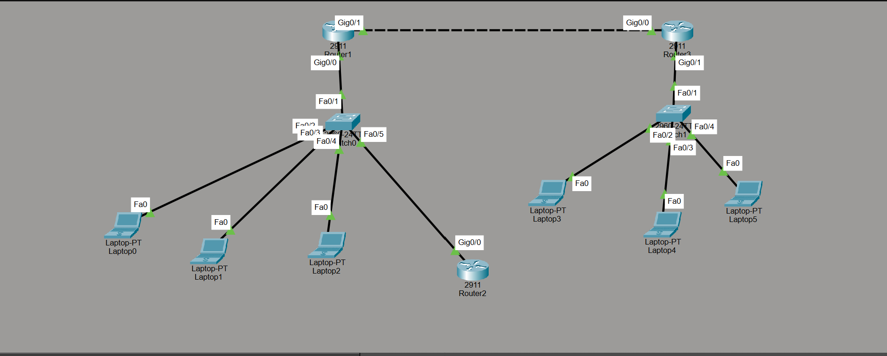

# Centralized DHCP & VLAN Network Lab

## Topology Overview

এই Lab-এ তিনটি Router, দুটি Switch এবং একাধিক Laptop ব্যবহার করে Network তৈরি করা হয়েছে।

### Network Design

- **Router 1:** Central DHCP Server হিসেবে কাজ করছে।
- **Router 1 VLAN:** Router 1-এর Switch-এর সঙ্গে সংযুক্ত Client-দের DHCP Configuration প্রদান করে।
- **Router 3 VLAN:** Router 3-এর Switch-এর Client-দের IP Configuration-ও Router 1 থেকে নিয়ন্ত্রণ করা হচ্ছে।
- **Router 2:** Wireless Network-এর জন্য রাখা হয়েছে।
- **Switches:** Router ও End Device-গুলোর মধ্যে Connectivity তৈরি করছে।

## Main Objectives

1. Router 1 থেকে Centralized DHCP Management করা।
2. Router 1 ও Router 3-এর VLAN-এর Client-দের Automatically IP Address প্রদান করা।
3. Router-গুলোর মধ্যে Network Connectivity তৈরি করা।
4. DHCP Relay ব্যবহার করে Remote VLAN-এ DHCP Request পৌঁছানো।
5. Router 2 দিয়ে Wireless Network তৈরি ও পরীক্ষা করা।

## Important Commands

### DHCP Verification (Router 1)

```cisco
show ip dhcp pool
show ip dhcp binding
show ip dhcp server statistics
```

### DHCP Relay (Remote VLAN Interface)

```cisco
interface gigabitEthernet 0/1
 ip helper-address <Router1-DHCP-IP>
```

### Connectivity Testing

```bash
ping <destination-ip>
ipconfig /all
```

## Expected Result

- Router 1 থেকে DHCP Management হবে।
- Router 1 ও Router 3-এর VLAN-এর Client-রা Automatically IP Address পাবে।
- Router-গুলোর মধ্যে Communication কাজ করবে।
- Router 2-এর Wireless Connectivity পরীক্ষা করা যাবে.

**Note:** VLAN ID, IP Address এবং Subnet অনুযায়ী Configuration করতে হবে।